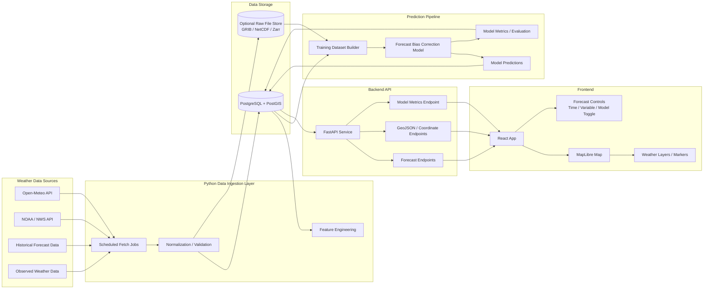
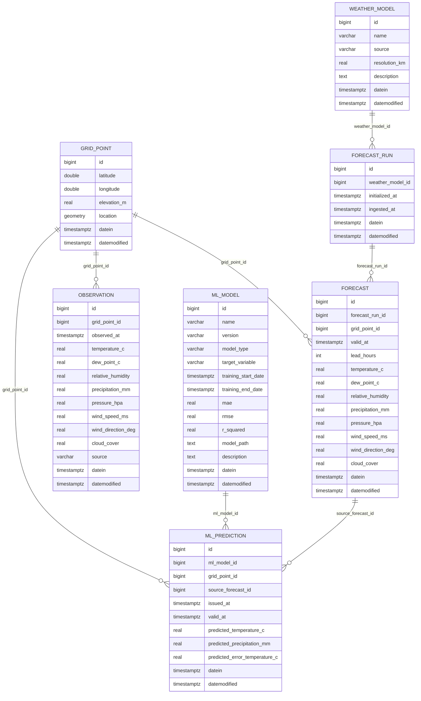

# WeatherMapping
This repository is going to be a weather mapping project, ultimately this will be used to provide insights that can be used to predict other things (betting on outdoor sports, stock prediction, shipping effects, etc.)

## Future State

## DB Model Plan:

